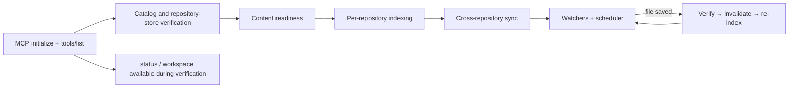

# 📘 Attic — Operations & Development Playbook

Practical manual for running, troubleshooting, recovering and extending Attic.
For what Attic is, start with the [README](../README.md); for how it is built,
[`ARCHITECTURE.md`](ARCHITECTURE.md).

## Contents

- [Operation](#operation)
  - [Start and stop](#start-and-stop) · [Indexing lifecycle](#indexing-lifecycle)
  - [Checking health](#checking-health) · [Managing repositories](#managing-repositories)
  - [Several windows, one workspace](#several-windows-one-workspace)
  - [Project knowledge](#project-knowledge) · [MCP tools](#mcp-tools)
- [Troubleshooting](#troubleshooting)
- [Recovery](#recovery)
- [Adding a language or platform](#adding-a-language-or-platform)
- [Development](#development)
- [Maintenance](#maintenance)

## Operation

### Start and stop

Your MCP client normally starts Attic for you. To run it by hand, set a
workspace root and launch the installed binary.

<details open>
<summary><b>PowerShell</b></summary>

```powershell
$env:ATTIC_WORKSPACE_ROOT = 'C:\code\repo'
~\.attic\attic-server.exe
```

</details>

<details>
<summary><b>cmd.exe</b></summary>

```bat
set ATTIC_WORKSPACE_ROOT=C:\code\repo
%USERPROFILE%\.attic\attic-server.exe
```

</details>

<details>
<summary><b>Linux / macOS shell</b></summary>

```sh
ATTIC_WORKSPACE_ROOT=/code/repo ~/.attic/attic-server
```

</details>

With no workspace configured anywhere, Attic starts **unconfigured**: it
answers `status` and `workspace`, and query tools return a clear "workspace
not configured" error until you add a repository.

Attic stops on Ctrl+C, or — as a daemon — once no client has been connected
for the idle timeout (90 s by default). Both paths run graceful shutdown: stop accepting work, stop watchers and the
scheduler, drain bounded writer work, checkpoint stores and close databases.

> [!NOTE]
> On macOS, a replacement daemon can take over a killed daemon's leftover
> socket file, so relay/daemon failover does not require manual socket cleanup.

### Indexing lifecycle



- **Startup** — MCP initialization, tool discovery and `status` are independent
  of repository-index readiness. `workspace` actions and content-serving tools
  require completed catalog verification; content is never served from an
  unchecked store.
- **Verification** — each configured repository has an isolated SQLite index.
  Verification can take longer than a client's connection deadline for a
  large store; a responsive MCP handshake does not mean indexed content is
  ready. Retry content requests after `status` reports readiness.
- **Indexing** — each repository is indexed independently. Unchanged files can
  reuse cached analysis; cross-repository relationships are synchronized
  across configured members only.
- **Incremental** — a native file watcher (falling back to periodic
  reconciliation if the OS watch cannot be established) detects changes,
  verifies content hashes, invalidates affected artifacts and re-indexes
  changed files. `status` reports watcher and indexing state.

### Checking health

Ask your client for Attic's status, or call the `status` tool. Key fields:

| Field | Meaning |
|---|---|
| `status` | `ok`, or `unconfigured` until a repository is configured |
| `workspace.repositories[]` | Per-repository state, watcher mode and any error |
| `incremental.state` | `CURRENT` / `INDEXING` / `RECONCILIATION_REQUIRED` / `UNKNOWN` |
| `incremental.tasks` | Pending/running background tasks |
| `retrieval_telemetry` | Recent retrieval-plan outcomes by mode and result |
| `diagnostics.why_slow` | Plain-language bottleneck diagnosis |
| `resource_pressure` | Memory tier (`normal`/`warning`/`critical`/`emergency`) and effective limits |
| `resource_mode` / `resource_mode_source` | Selected low/balanced/performance tier and where it came from |

### Managing repositories

Membership is managed live through the `workspace` tool — no restart, no file
editing. Tell your client *"add D:\new-service to Attic"*, or call it directly:

| Action | Effect |
|---|---|
| `{"action":"inspect"}` | Configured and active roots, per-repository state |
| `{"action":"add","path":"..."}` | Validate, index, watch and persist a new root |
| `{"action":"remove","path":"..."}` | Stop watching; the repository immediately disappears from search, context and status |
| `{"action":"set","paths":[...]}` | Replace the whole membership |

Membership is written atomically to `<ATTIC_HOME>/config/config.toml`. A
removed repository disappears from results immediately. Its manager-owned
index may be reclaimed after active readers release their leases; adding it
back before cleanup completes cancels pending cleanup. Legacy databases and
model files are not managed or deleted. A configured root that is temporarily
unavailable (say, an unmounted drive) is reported under
`workspace.unavailable_repositories` while the others keep working. At most
65 active managed repository stores can be open at once; excess roots are
reported as bootstrap failures rather than silently served from an unchecked
or unavailable store.

### Several windows, one workspace

Any number of clients may launch Attic against the same `ATTIC_HOME`. The
first launch becomes the **daemon** (single writer, watchers, recovery); later
launches become **relays** over a local socket (Unix domain socket or Windows
named pipe). If the daemon exits or crashes, a relay re-elects itself as the
daemon without disconnecting its own client. Different `ATTIC_HOME`s are fully
independent workspaces.

### Project knowledge

Create `knowledge/*.md` files in a repository for durable facts that the code
does not show: architecture rationale, domain vocabulary, conventions,
ownership, deployment topology. See [`knowledge/README.md`](../knowledge/README.md)
for the template.

- Keep one topic per file; edit it like any other file — the watcher
  re-indexes it.
- A contradiction between knowledge and current source is **surfaced**, never
  silently resolved — treat it as a sign the knowledge file needs updating.
- Never store secrets there: knowledge files are served like source code.

### MCP tools

| Tool | Purpose |
|---|---|
| `context` | Evidence-backed answer (`FAST`, `NORMAL`, `DEEP`), lexical `SEARCH`, or bounded syntactic `REFERENCES` |
| `file` | Read a bounded, sanitized file range, JSON pointer/unit, outline, or literal/regex matches |
| `repo_map` | Inspect repository structure and indexing statistics |
| `status` | Readiness, per-repository indexing/watch state, resource pressure and retrieval telemetry |
| `workspace` | Inspect or change configured repository roots |
| `logging` | Enable/disable file logging or change log level |
| `debug_drain_task` | Admin-only: run one pending incremental task synchronously |

Tool schemas are returned by MCP `tools/list`; their source of truth is
`crates/attic-server/src/tools.rs::make_tools()`. Search is lexical (SQLite
FTS5) and graph-assisted. Attic does not generate embeddings or claim vector
similarity; vague conceptual queries can retrieve differently than with a
vector search engine.

For a structured workflow, search relevant identifiers with `mode: "SEARCH"`
and an exact `path` or other explicit scope, expand a returned JSON pointer or
unit using `file`, then use `mode: "REFERENCES"` for literal links. Adjacent
search terms use ranked OR; choose `match_mode: "all"` for strict matching.
`repository` accepts an unambiguous active name, UUID or absolute root.
Answer modes without explicit path scope may also include central knowledge
and workspace dependency evidence, even for a selected repository.
Check `path_resolution`, indexed location status, response omissions and
reference coverage; an empty reference result is conclusive only when
`coverage.absence_proven` is true. Rebuild and restart the server, then
reindex affected repositories to populate new JSON source locations.

For answer modes, read top-level `context`, `claims` and `evidence`.
`repository_answers` contains summaries only. Shared excerpts retain all
repository/path citations; use `file` to expand a returned source span.
Rejection counts/reasons appear in `evidence_dropped_summary`; individual
rejections require `include_diagnostics: true`. Inspect response `telemetry`
and managed-tool timing logs to separate server work from client processing.
See [PERFORMANCE.md](PERFORMANCE.md) for field definitions and compatibility notes.

### Attic home layout

`ATTIC_HOME` defaults to `~/.attic`. Managed state lives under `data/`
(catalog and per-repository indexes), `config/` (`config.toml` for workspace
membership and `attic.toml` for tunables) and `run/` (daemon lock/address).
`logs/` is created only when file logging is enabled. Legacy `attic.db`,
`semantic.db` and model files are preserved; they are not used by current
retrieval and are not automatically deleted.

## Troubleshooting

| Problem | What to check |
|---|---|
| MCP won't connect | Absolute `command` path; errors are on **stderr** — stdout carries only MCP |
| MCP connects but content tools are not ready | Check `status`; large SQLite integrity checks can continue after initialization and may exceed a client's deadline |
| Exits immediately | stderr: invalid config or `ATTIC_*` value, unreadable root, failed integrity check |
| Repository missing | `workspace {"action":"inspect"}`; `status.workspace.unavailable_repositories` |
| File missing | `.gitignore`, built-in skipped folders, `[indexing] exclude` |
| Results stale | `status.incremental.state`; the `file` tool reads live and appends an `[index freshness: …]` note on drift |
| Indexing seems stuck | `status.incremental.tasks` not decreasing across calls; stderr scheduler errors |
| Watcher degraded | `status.watcher.mode` = `periodic-reconciliation` — a documented fallback, not a crash |
| Cross-repo answers withheld | Startup cross-repo sync not finished or failed (stderr `cross-repo workspace sync failed`); single-repo retrieval unaffected |
| "server busy" / memory | `status.resource_pressure`; raise `total_memory_budget_mib` / `max_foreground_queries`, or index fewer repositories at once |
| Disk usage | Check `data/catalog.db` and `data/repositories/*/index.db`; legacy files are preserved and can be removed only by an explicit operator decision |

<details>
<summary><strong>Details and diagnostics</strong></summary>

- **Relay says the daemon never published an address.** Another process holds
  `attic.lock` but has no `attic.ipc`: it is still starting, serving a single
  client because its socket could not be created, or hung. Stop it and
  relaunch. On macOS, a replacement daemon can take over a killed daemon's
  leftover socket file.
- **"workspace not configured"** is the intended first-run state — configure
  through the `workspace` tool, `ATTIC_CONFIG` or `ATTIC_WORKSPACE_ROOT`.
- **Readiness diagnostics.** Use `status` to distinguish MCP connectivity
  from per-repository store verification and indexing readiness.

</details>

## Recovery

| Situation | What to do |
|---|---|
| Killed during startup or indexing | Restart Attic and inspect `status`; interrupted manager-owned initialization is retried and partial generations are not served |
| Store verification takes too long | Keep the daemon running and retry content requests after `status` reports readiness; do not remove SQLite files while the daemon is active |
| Integrity check fails | Do not overwrite or delete the affected store. Preserve the files and backups, capture stderr/status, then diagnose or restore from a verified backup |
| "schema version not supported" | Preserve the database and use a binary compatible with its schema; do not reset unknown schemas |

Attic never writes into a workspace, so recovery does not alter source files.
Legacy databases and model files are not automatically migrated or deleted.

## Adding a language or platform

Every language or platform is an **analyzer plugin**
(`crates/attic-analyzers/src/plugin.rs`). Pick the smallest path that fits.
Paths A and C leave indexing, storage, retrieval and the server untouched; a
full analyzer (path B) also adds one import-resolver arm to `resolve_import` in
`crates/attic-indexing/src/structural_pipeline.rs` so its imports resolve to
repository files:

| Path | Effort | You get | Example |
|---|---|---|---|
| **A · Tags query** | ~30 lines | Symbol definitions + in-file references | A language not yet covered |
| **B · Full analyzer** | A few hundred lines + a resolver arm | Symbols, imports, inheritance, calls | Java, Python, Go, Kotlin, Rust, C++ (all 16 full languages) |
| **C · Platform plugin** | Your own `AnalyzerPlugin` | Path-aware classification + custom structure | AEM |

> The worked example in path A below uses Kotlin to show the tags-query
> mechanism; Kotlin itself now has a full analyzer (path B).

<details open>
<summary><b>A · A language with a tree-sitter grammar (worked example: Kotlin)</b></summary>

1. **Add the grammar** to the workspace `Cargo.toml` and to
   `crates/attic-analyzers/Cargo.toml`:

   ```toml
   tree-sitter-kotlin-ng = { workspace = true }   # workspace: "1.1"
   ```

2. **Write (or reuse) a tags query** in
   `crates/attic-analyzers/src/structural/tags_generic.rs`. Use the grammar's
   own `queries/tags.scm` when it ships one; otherwise author the definitions
   you want from its `node-types.json`:

   ```rust
   const KOTLIN_TAGS_QUERY: &str = r#"
   (class_declaration name: (identifier) @name) @definition.class
   (object_declaration name: (identifier) @name) @definition.object
   (function_declaration name: (identifier) @name) @definition.function
   "#;
   ```

3. **Add one row** to the language table in the same file:

   ```rust
   TagsLanguageSpec {
       analyzer_id: "kotlin-tags",
       language_tag: "kotlin",
       description: "tree-sitter-tags structural analyzer for Kotlin: …",
       grammar: tree_sitter_kotlin_ng::LANGUAGE,
       tags_query: KOTLIN_TAGS_QUERY,
       locals_query: "",
   },
   ```

4. **Claim the file extensions** with one line in `builtin_plugins()` in
   `plugin.rs`:

   ```rust
   tier2("kotlin", "Kotlin: classes, objects, functions and type aliases",
         &[], &[("kt", "kotlin"), ("kts", "kotlin")]),
   ```

5. **Test it** with a small fixture in
   `crates/attic-analyzers/tests/structural_tags_tier2.rs`, and add the id to
   the `Built-in ids` comment in `ATTIC_TOML_TEMPLATE`
   (`crates/attic-core/src/config.rs`) — a unit test fails until you do.

</details>

<details>
<summary><b>B · A full, hand-written analyzer</b></summary>

Implement `TreeSitterLanguageSpec` in a new module under
`crates/attic-analyzers/src/structural/` (use `java.rs` or `python.rs` as the
template: symbols, imports, heritage, calls), then register it in
`builtin_plugins()` with `Registration::Specialized(your_module::analyzer)`.
Declare capabilities honestly in the analyzer descriptor — never claim a
relationship level the analyzer does not produce. Add a fixture under
`crates/attic-analyzers/tests/fixtures/` and cover it in
`language_specific_extraction.rs` and `language_invariants_matrix.rs`.

</details>

<details>
<summary><b>C · A platform plugin (like AEM)</b></summary>

Implement the four-method trait. Paths arrive normalized (`/` separators,
lowercase), so a plugin behaves identically on Windows, macOS and Linux:

```rust
use std::sync::Arc;
use attic_analyzers::{AnalyzerPlugin, AnalyzerRegistry, PluginPath};

struct TerraformPlugin;

impl AnalyzerPlugin for TerraformPlugin {
    fn id(&self) -> &'static str { "terraform" }                  // attic.toml id
    fn description(&self) -> &'static str { "Terraform modules and resources" }
    fn language_hint(&self, path: &PluginPath) -> Option<&'static str> {
        matches!(path.extension(), Some("tf") | Some("tfvars")).then_some("terraform")
    }
    fn register(&self, registry: &mut AnalyzerRegistry) {
        registry.register_for_language("terraform", Arc::new(TerraformAnalyzer::new()));
    }
}
```

Add it to `builtin_plugins()` — before the generic extension rules if it
claims paths by layout, as `aem.rs` does for `jcr_root/` — or compose it at
runtime with `PluginCatalog::builtin().with_plugin(Arc::new(TerraformPlugin))`
(duplicate ids are rejected). Parse tolerantly: malformed input should yield
partial structure plus a warning, never a failed file.

</details>

**Rules for every path:** a disabled plugin's files stay searchable through
`GenericAnalyzer`; plugin ids are lowercase and stable (they appear in
`attic.toml`); and bump `ANALYZER_REGISTRY_VERSION`
(`crates/attic-core/src/constants.rs`) whenever an existing analyzer's output
changes, so cached analyses are recomputed on the next start.

## Development

> [!WARNING]
> These commands run Cargo. Do not run them while another build is holding the
> target lock unless you intentionally want to wait.

```sh
rustup show                                   # installs the pinned toolchain
cargo build --package attic-server            # debug build → target/debug/attic
cargo test -p <crate>                         # focused, fast inner loop
cargo test --workspace                        # everything
cargo fmt --all
cargo clippy --workspace --all-targets -- -D warnings
```

### Pre-commit checks and local install

The same commands work on Windows, Linux and macOS:

```sh
cargo xtask check
cargo xtask install
```

`cargo xtask check` is exactly:

```sh
cargo fmt --all --check
cargo clippy --workspace --all-targets -- -D warnings
cargo test --workspace
```

`cargo xtask install` builds and installs `attic-server` into the selected
installation. It does not download models or install GPU runtimes. On Windows
it builds for MSVC unless `CARGO_BUILD_TARGET` is set. `cargo xtask all`
formats, checks, tests, builds and installs.

<details>
<summary><b>Toolchains per platform</b></summary>

- **Windows (recommended):** rustup's default `x86_64-pc-windows-msvc` plus
  Build Tools for Visual Studio with the C++ workload.

  `cargo xtask` builds for MSVC automatically when `CARGO_BUILD_TARGET` is
  unset. For plain `cargo` commands with a personal Cargo config that forces
  GNU (`x86_64-pc-windows-gnu`), override it:

  ```powershell
  $env:CARGO_BUILD_TARGET = 'x86_64-pc-windows-msvc'
  cargo xtask check
  cargo xtask install
  ```

  In `cmd.exe`:

  ```bat
  set CARGO_BUILD_TARGET=x86_64-pc-windows-msvc
  cargo xtask check
  cargo xtask install
  ```

- **Linux:** a system C compiler (`build-essential` / `gcc`).
- **macOS:** `xcode-select --install`. Apple Silicon gets Metal automatically
  through `cargo xtask install`; Intel Mac uses CPU.

</details>

<details>
<summary><b>Opt-in tests, benchmarks and test hooks</b></summary>

| Variable | Purpose |
|---|---|
| `ATTIC_BENCH_INDEX=1` (+ `ATTIC_BENCH_ROOT`, …) | Indexing benchmark — see [`PERFORMANCE.md`](PERFORMANCE.md) |
| `ATTIC_ACCEPTANCE_DUMP=<dir>` | Frozen-count acceptance run over the reference JSON-export corpus |
| `ATTIC_ACCEPTANCE_WORKSPACE=<dir>` | Frozen-count acceptance run over the reference 20-repository workspace |
| `ATTIC_FORCE_RESOURCE_PRESSURE` | Fault injection: start at a fixed pressure tier |
| `ATTIC_FORCE_CPU_CORES=<n>` | Test hook: pin the detected physical core count so resource tests don't depend on the machine |
| `ATTIC_PRESSURE_OVERRIDE_FILE` | Fault injection: a file whose content (`normal`…`emergency`) forces the tier while it exists |
| `ATTIC_FAST_RECOVERY_MS` | Fault injection: shorten graduated-recovery dwell times |

The acceptance runs assert exact counts for their reference corpora and are
skipped when the variable is unset; everything else in the suite is
self-contained (temporary directories, no network, no global Git config).

</details>

`target/` is Cargo's build cache, not Attic's index — `cargo clean` is always
safe.

## Maintenance

<details open>
<summary><strong>Procedures</strong></summary>

- **Schema changes** — migrations are ordered and forward-only. Add
  `migrations/000N_<name>.sql` (wired into `run_migrations` in
  `crates/attic-storage/src/migration.rs`). Each script records itself; never
  edit one that has shipped. Unknown schemas must be refused, not reset.
- **Analyzer or grammar update** — bump the `tree-sitter-*` dependency, check
  its ABI against `tree-sitter`'s supported range, re-run the analyzer tests,
  and bump `ANALYZER_REGISTRY_VERSION` if output changes.
- **New dependency** — its license must be compatible with
  `MIT OR Apache-2.0`, and it must support Linux, macOS and Windows.
- **Retrieval changes** — modify contracts or candidate generation in
  `crates/attic-retrieval`, then run its regression gates in
  `crates/attic-retrieval/tests/`.
- **Release** — bump `version` in the root `Cargo.toml`; CI
  (`.github/workflows/release.yml`) runs `tools/package.sh --target <triple>`
  for every supported target on tag push. Never weaken
  `tools/package.sh --verify`'s exclusion checks (no `target/`, `*.db*`, logs
  or hidden files) to make a release pass, and never work around a build
  failure by weakening endpoint security (antivirus exclusions, signing
  bypasses) — find the actual cause.

</details>
